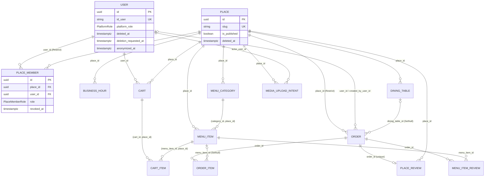

# Perancangan Basis Data

Dokumen ini merupakan ekstraksi evidence teknis tentang desain basis data Tooang yang relevan dengan RBAC dan multi-tenancy. Status yang digunakan adalah `IMPLEMENTED`, `DOCUMENTED`, `DOCUMENTATION / IMPLEMENTATION GAP`, dan `NOT FOUND IN REPOSITORY`. Sama seperti `01_arsitektur_dan_teknologi.md`, istilah _tenant_ merujuk pada entitas `Place`.

Sumber utama adalah Prisma schema (`backend/prisma/schema.prisma`) dan migration chain (`backend/prisma/migrations/`). Untuk constraint yang tidak dapat diekspresikan oleh Prisma schema (CHECK constraint, trigger, composite foreign key yang ditambahkan melalui SQL), migration SQL dijadikan sumber acuan. Kode repository/service hanya dirujuk untuk menunjukkan bagaimana struktur database dikonsumsi; uraian logika bisnis berada pada `03_fitur_dan_logika_bisnis.md`.

## 1. Ringkasan Database

### `IMPLEMENTED`

| Aspek             | Fakta yang ditemukan                                                                                                                                               |
| ----------------- | ------------------------------------------------------------------------------------------------------------------------------------------------------------------ |
| DBMS              | PostgreSQL (`datasource db { provider = "postgresql" }`).                                                                                                          |
| ORM / client      | Prisma, generator `prisma-client` dengan output `../generated/prisma` dan `moduleFormat = "cjs"`.                                                                 |
| Jumlah model      | 19 model.                                                                                                                                                          |
| Jumlah enum       | 11 enum.                                                                                                                                                           |
| Primary key       | Seluruh model memakai `String @id @default(uuid())`, kecuali `AuthRateLimitBucket` yang memakai composite primary key `(sourceHash, policy)`.                      |
| Penamaan          | Nama model PascalCase dipetakan ke tabel snake_case melalui `@@map`; field camelCase dipetakan ke kolom snake_case melalui `@map`.                                 |
| Tipe waktu        | Kolom instant memakai `@db.Timestamptz(3)`; jam operasional (`opensAt`, `closesAt`) memakai `@db.Time(0)`.                                                         |
| Migration         | 9 migration berurutan berdasarkan timestamp, dari `20260912082709_init` sampai `20260927120000_add_category_thumbnails_and_manual_orders`.                         |

Source:

- `backend/prisma/schema.prisma:1-11`
- `backend/prisma/schema.prisma:13-83`
- `backend/prisma/schema.prisma:85-500`
- `backend/prisma/schema.prisma:133-144`
- `backend/prisma/migrations/` (9 direktori migration)

Model dikelompokkan sebagai berikut menurut perannya terhadap fokus penelitian:

| Kelompok                     | Model                                                                                                    |
| ---------------------------- | -------------------------------------------------------------------------------------------------------- |
| Identity, role, dan session  | `User`, `RefreshSession`, `AuthRateLimitBucket`                                                          |
| Tenant dan membership        | `Place`, `PlaceMember`                                                                                   |
| Tenant-scoped resource       | `BusinessHour`, `DiningTable`, `MenuCategory`, `MenuItem`, `MediaUploadIntent`, `Cart`, `CartItem`, `Order`, `PlaceReview` |
| Resource terkait tenant secara tidak langsung | `OrderItem`, `MenuItemReview`, `MediaAsset`                                              |
| Audit dan infrastruktur      | `AuditLog`, `IdempotencyKey`                                                                             |

Source:

- `backend/prisma/schema.prisma:85-500`

Prisma schema diawali komentar `// Digital food menu, RBAC, reviews, carts, and cashier-verifiable orders.`

Source:

- `backend/prisma/schema.prisma:1`

## 2. Entitas Utama

### 2.1 User

### `IMPLEMENTED`

Tabel: `users`.

| Field                 | Kolom                   | Tipe / atribut                                   | Nullable | Keterangan                                                    |
| --------------------- | ----------------------- | ------------------------------------------------ | -------- | ------------------------------------------------------------- |
| `id`                  | `id`                    | `String @id @default(uuid())`                    | Tidak    | Primary key internal; dipakai oleh seluruh foreign key.       |
| `userId`              | `id_user`               | `String @unique`                                 | Tidak    | Identifier publik.                                            |
| `fullName`            | `full_name`             | `String`                                         | Tidak    |                                                               |
| `email`               | `email`                 | `String @unique @db.VarChar(254)`                | Tidak    |                                                               |
| `passwordHash`        | `password_hash`         | `String`                                         | Tidak    |                                                               |
| `platformRole`        | `platform_role`         | `PlatformRole @default(USER)`                    | Tidak    | Platform role yang dipersistenkan.                            |
| `deletedAt`           | `deleted_at`            | `DateTime? @db.Timestamptz(3)`                   | Ya       | Penanda nonaktif/soft delete.                                 |
| `deletionRequestedAt` | `deletion_requested_at` | `DateTime? @db.Timestamptz(3)`                   | Ya       | Penanda permintaan penghapusan akun.                          |
| `anonymizedAt`        | `anonymized_at`         | `DateTime? @db.Timestamptz(3)`                   | Ya       | Penanda anonimisasi.                                          |

Relasi keluar dari `User`: `placeMemberships`, `placeReviews`, `menuItemReviews`, `carts`, `customerOrders` (`OrderCustomer`), `createdOrders` (`OrderCreator`), `idempotencyKeys`, `refreshSessions`, `auditLogs` (`AuditActor`), dan `mediaUploadIntents`.

Index: `(platformRole, deletedAt)`, `(deletedAt, createdAt)`, `(anonymizedAt, deletionRequestedAt)`. Unique index: `id_user` dan `email`.

`User` tidak menyimpan `placeId` atau place role. Hubungan user dengan tenant hanya melalui `PlaceMember`, sedangkan hubungan dengan resource milik user melalui foreign key pada `Cart`, `Order`, review, dan session.

Source:

- `backend/prisma/schema.prisma:85-112`
- `backend/prisma/migrations/20260912082709_init/migration.sql:26-39`
- `backend/prisma/migrations/20260912082709_init/migration.sql:300-309`
- `backend/prisma/migrations/20260914120000_harden_database_constraints/migration.sql:261-263`

Penggunaan dua identifier (internal `id` untuk relasi, `userId` untuk API) sesuai dengan SRS-DATA-001. Contoh di kode: lookup user target memakai public `userId`, sedangkan membership disimpan dengan internal `id`.

Source:

- `backend/docs/software-requirement-specification.md:499`
- `backend/src/modules/places/places.repository.ts:325-330`
- `backend/src/modules/places/place-members.service.ts:47-50`

### 2.2 Place / Tenant

### `IMPLEMENTED`

Tabel: `places`. Tidak terdapat model bernama `Tenant`; `Place` adalah entitas induk bagi resource place-scoped.

| Field               | Kolom                 | Tipe / atribut                       | Nullable | Keterangan                                    |
| ------------------- | --------------------- | ------------------------------------ | -------- | --------------------------------------------- |
| `id`                | `id`                  | `String @id @default(uuid())`        | Tidak    | Tenant key yang dirujuk oleh `place_id`.      |
| `name`              | `name`                | `VarChar(120)`                       | Tidak    |                                               |
| `slug`              | `slug`                | `VarChar(100) @unique`               | Tidak    | Unik secara global.                           |
| `type`              | `type`                | `PlaceType`                          | Tidak    | `RESTAURANT`, `CAFE`, `FOOD_STALL`, `OTHER`.  |
| `timezone`          | `timezone`            | `String`                             | Tidak    |                                               |
| `logoAssetId`       | `logo_asset_id`       | `String? @unique`                    | Ya       | FK ke `MediaAsset`, `onDelete: SetNull`.      |
| `coverAssetId`      | `cover_asset_id`      | `String? @unique`                    | Ya       | FK ke `MediaAsset`, `onDelete: SetNull`.      |
| `isPublished`       | `is_published`        | `Boolean @default(false)`            | Tidak    | Penanda visibilitas publik.                   |
| `isOrderingEnabled` | `is_ordering_enabled` | `Boolean @default(false)`            | Tidak    |                                               |
| `deletedAt`         | `deleted_at`          | `DateTime? @db.Timestamptz(3)`       | Ya       | Soft delete.                                  |

Kolom deskriptif lain: `description`, `address`, `city`, `latitude`, `longitude`, `phone`, `whatsapp`.

Relasi keluar dari `Place`: `members`, `businessHours`, `diningTables`, `categories`, `menuItems`, `reviews`, `carts`, `orders`, `mediaUploadIntents`, `logoAsset`, `coverAsset`.

Index: `(isPublished, deletedAt, createdAt)`, `(type, isPublished, deletedAt)`, `(city, isPublished, deletedAt)`.

`Place` tidak memiliki kolom `ownerId`. Kepemilikan dinyatakan melalui `PlaceMember` (lihat §5.2).

Source:

- `backend/prisma/schema.prisma:24-29`
- `backend/prisma/schema.prisma:166-202`
- `backend/prisma/migrations/20260912082709_init/migration.sql:71-92`
- `backend/prisma/migrations/20260912082709_init/migration.sql:336-348`
- `backend/prisma/migrations/20260914180000_add_place_city_discovery_index/migration.sql:1-2`

### 2.3 Membership

### `IMPLEMENTED`

Tabel: `place_members`. Entitas ini menghubungkan `User` dan `Place` sekaligus menyimpan place role.

| Field       | Kolom        | Tipe / atribut                 | Nullable | Keterangan                                                  |
| ----------- | ------------ | ------------------------------ | -------- | ----------------------------------------------------------- |
| `id`        | `id`         | `String @id @default(uuid())`  | Tidak    | Primary key.                                                |
| `placeId`   | `place_id`   | `String`                       | Tidak    | FK ke `places.id`, `ON DELETE CASCADE ON UPDATE CASCADE`.   |
| `userId`    | `user_id`    | `String`                       | Tidak    | FK ke `users.id` (internal), `ON DELETE RESTRICT ON UPDATE CASCADE`. |
| `role`      | `role`       | `PlaceMemberRole`              | Tidak    | `OWNER` atau `CASHIER`; tanpa default.                      |
| `createdAt` | `created_at` | `Timestamptz(3)`               | Tidak    |                                                             |
| `updatedAt` | `updated_at` | `Timestamptz(3)`               | Tidak    |                                                             |
| `revokedAt` | `revoked_at` | `DateTime? @db.Timestamptz(3)` | Ya       | `null` berarti membership aktif.                            |

Constraint dan index:

- Unique `(placeId, userId)` dengan nama `place_members_place_id_user_id_key`.
- Index `(placeId, revokedAt, role)` dan `(userId, revokedAt, role)`.

Kardinalitas: satu `User` dapat memiliki nol atau lebih `PlaceMember`; satu `Place` dapat memiliki nol atau lebih `PlaceMember`; untuk setiap pasangan `(Place, User)` maksimal ada satu baris, termasuk baris yang sudah di-revoke.

Source:

- `backend/prisma/schema.prisma:19-22`
- `backend/prisma/schema.prisma:204-219`
- `backend/prisma/migrations/20260912082709_init/migration.sql:96-105`
- `backend/prisma/migrations/20260912082709_init/migration.sql:351-357`
- `backend/prisma/migrations/20260912082709_init/migration.sql:462-465`

Perilaku "satu baris per pasangan, termasuk baris revoked" diuji pada E2E database: setelah membership `OWNER` yang sudah di-revoke dibuat, pembuatan membership `CASHIER` kedua untuk pasangan yang sama diharapkan ditolak database.

Source:

- `backend/test/database-constraints.e2e-spec.ts:618-625`

### 2.4 Role

### `IMPLEMENTED`

Role dipersistenkan sebagai nilai enum PostgreSQL, bukan sebagai baris tabel:

| Enum              | Nilai                           | Dipakai oleh                                     |
| ----------------- | ------------------------------- | ------------------------------------------------ |
| `PlatformRole`    | `SUPER_ADMIN`, `ADMIN`, `USER`  | `User.platformRole` (default `USER`)             |
| `PlaceMemberRole` | `OWNER`, `CASHIER`              | `PlaceMember.role` (tanpa default)               |

Kedua enum dibuat sebagai PostgreSQL type pada migration init.

Source:

- `backend/prisma/schema.prisma:13-22`
- `backend/prisma/schema.prisma:91`
- `backend/prisma/schema.prisma:208`
- `backend/prisma/migrations/20260912082709_init/migration.sql:2-5`

### `NOT FOUND IN REPOSITORY`

Tabel `Role`, `UserRole`, atau tabel lain yang menyimpan role secara dinamis tidak ditemukan. Hal ini sesuai dengan SRS-DATA-016 dan SRS-USR-011, serta dengan pernyataan `application-rules.md` bahwa versi 1 tidak memiliki tabel `Role`, `UserRole`, `Permission`, `RolePermission`, atau `PlaceOwner`.

Source:

- `backend/prisma/schema.prisma:85-500`
- `backend/docs/software-requirement-specification.md:293`
- `backend/docs/software-requirement-specification.md:526`
- `backend/docs/application-rules.md:23`

### 2.5 Permission

### `NOT FOUND IN REPOSITORY`

Tidak ada model atau tabel permission maupun role-permission mapping di Prisma schema dan migration.

Source:

- `backend/prisma/schema.prisma:85-500`
- `backend/docs/authorization-data-model-reconciliation.md:105`
- `backend/docs/authorization-data-model-reconciliation.md:123`

### `IMPLEMENTED`

Permission identifier dan role-to-permission mapping didefinisikan sebagai konstanta di source code, lalu dikaitkan dengan nilai enum `PlatformRole` dan `PlaceMemberRole` yang dipersistenkan. Dengan demikian, database hanya menyimpan *role assignment*, sedangkan *permission grant* diturunkan di aplikasi. Rincian permission dijelaskan di `01_arsitektur_dan_teknologi.md` §4.3.

Source:

- `backend/src/common/auth/permissions.ts:9-73`
- `backend/src/common/auth/permissions.ts:83-177`
- `backend/docs/software-requirement-specification.md:527`

### 2.6 Tenant-Scoped Resources

### `IMPLEMENTED`

Tabel berikut mencatat referensi tenant untuk setiap resource. "Langsung" berarti tabel memiliki kolom `place_id` dengan foreign key ke `places`. "Tidak langsung" berarti keterkaitan dengan tenant hanya dapat ditelusuri melalui relasi lain.

| Model / tabel                           | Referensi tenant                                     | Unique per tenant / composite key               | Foreign key penting (onDelete)                                                                                                            |
| --------------------------------------- | ---------------------------------------------------- | ----------------------------------------------- | ----------------------------------------------------------------------------------------------------------------------------------------- |
| `BusinessHour` / `business_hours`       | Langsung `placeId`                                   | `(placeId, day)`                                | `placeId → places` (Cascade)                                                                                                              |
| `DiningTable` / `dining_tables`         | Langsung `placeId`                                   | `(placeId, normalizedName)`                     | `placeId → places` (Cascade)                                                                                                              |
| `MenuCategory` / `menu_categories`      | Langsung `placeId`                                   | `(placeId, normalizedName)`; `(id, placeId)`    | `placeId → places` (Cascade); `thumbnailAssetId → media_assets` (SetNull)                                                                  |
| `MenuItem` / `menu_items`               | Langsung `placeId`                                   | `(id, placeId)`                                 | `placeId → places` (Cascade); **composite** `(categoryId, placeId) → menu_categories(id, place_id)` (Restrict); `imageAssetId` (SetNull) |
| `MediaUploadIntent` / `media_upload_intents` | Langsung `placeId`                              | —                                               | `placeId → places` (Cascade); **composite** `(categoryId, placeId)` dan `(menuItemId, placeId)` (Cascade); `actorUserId → users` (Restrict) |
| `Cart` / `carts`                        | Langsung `placeId`                                   | `(userId, placeId)`; `(id, placeId)`            | `placeId → places` (Cascade); `userId → users` (Cascade)                                                                                  |
| `CartItem` / `cart_items`               | Langsung `placeId` (ditambahkan pada migration hardening) | `(cartId, menuItemId)`                     | **composite** `(cartId, placeId) → carts(id, place_id)` (Cascade); **composite** `(menuItemId, placeId) → menu_items(id, place_id)` (Cascade) |
| `Order` / `orders`                      | Langsung `placeId`                                   | `orderCode` dan `verificationToken` unik global | `placeId → places` (Restrict); `diningTableId → dining_tables` (SetNull, FK tunggal); `userId`, `createdByUserId → users` (Restrict)       |
| `PlaceReview` / `place_reviews`         | Langsung `placeId`                                   | `orderId` unik                                  | `placeId → places` (Restrict); `orderId → orders` (Cascade); `userId → users` (Restrict)                                                  |
| `OrderItem` / `order_items`             | Tidak langsung, melalui `orderId → orders.place_id`  | —                                               | `orderId → orders` (Cascade); `menuItemId → menu_items` (SetNull, FK tunggal)                                                             |
| `MenuItemReview` / `menu_item_reviews`  | Tidak langsung, melalui `menuItemId` atau `orderId`  | `(orderId, menuItemId)`                         | `menuItemId → menu_items` (Restrict, FK tunggal); `orderId → orders` (Cascade)                                                            |
| `MediaAsset` / `media_assets`           | Tidak langsung, melalui `Place.logoAssetId`/`coverAssetId`, `MenuCategory.thumbnailAssetId`, `MenuItem.imageAssetId`, `MediaUploadIntent.completedAssetId` | Setiap kolom referensi asset bersifat unique | Tidak memiliki FK ke `places` |

Source:

- `backend/prisma/schema.prisma:221-249`
- `backend/prisma/schema.prisma:251-302`
- `backend/prisma/schema.prisma:304-353`
- `backend/prisma/schema.prisma:355-392`
- `backend/prisma/schema.prisma:394-483`
- `backend/prisma/migrations/20260912082709_init/migration.sql:360-444`
- `backend/prisma/migrations/20260912082709_init/migration.sql:468-528`
- `backend/prisma/migrations/20260914120000_harden_database_constraints/migration.sql:4-10`
- `backend/prisma/migrations/20260914120000_harden_database_constraints/migration.sql:123-150`
- `backend/prisma/migrations/20260914190000_add_media_upload_intents/migration.sql:34-41`
- `backend/prisma/migrations/20260927120000_add_category_thumbnails_and_manual_orders/migration.sql:22-35`

Model yang tidak bersifat tenant-scoped: `User`, `RefreshSession`, `AuthRateLimitBucket`, `AuditLog`, dan `IdempotencyKey`. Tidak satu pun dari model ini memiliki kolom `placeId`. `AuditLog` merujuk target melalui pasangan string `targetType`/`targetId` tanpa foreign key ke target tersebut.

Source:

- `backend/prisma/schema.prisma:114-164`
- `backend/prisma/schema.prisma:485-500`

## 3. Relasi Antarentitas

### `IMPLEMENTED`

Seluruh foreign key pada migration memakai `ON UPDATE CASCADE`. Kolom `onDelete` di bawah ini diambil dari schema dan migration.

| Dari (child)          | Ke (parent)           | Kolom FK                         | Kardinalitas                    | onDelete  |
| --------------------- | --------------------- | -------------------------------- | ------------------------------- | --------- |
| `PlaceMember`         | `Place`               | `place_id`                       | Place 1 — 0..N PlaceMember      | Cascade   |
| `PlaceMember`         | `User`                | `user_id`                        | User 1 — 0..N PlaceMember       | Restrict  |
| `BusinessHour`        | `Place`               | `place_id`                       | Place 1 — 0..7 (unik per `day`) | Cascade   |
| `DiningTable`         | `Place`               | `place_id`                       | Place 1 — 0..N                  | Cascade   |
| `MenuCategory`        | `Place`               | `place_id`                       | Place 1 — 0..N                  | Cascade   |
| `MenuItem`            | `Place`               | `place_id`                       | Place 1 — 0..N                  | Cascade   |
| `MenuItem`            | `MenuCategory`        | `(category_id, place_id)`        | Category 1 — 0..N               | Restrict  |
| `Cart`                | `User`                | `user_id`                        | User 1 — 0..N (maks. 1 per place) | Cascade |
| `Cart`                | `Place`               | `place_id`                       | Place 1 — 0..N                  | Cascade   |
| `CartItem`            | `Cart`                | `(cart_id, place_id)`            | Cart 1 — 0..N                   | Cascade   |
| `CartItem`            | `MenuItem`            | `(menu_item_id, place_id)`       | MenuItem 1 — 0..N               | Cascade   |
| `Order`               | `Place`               | `place_id`                       | Place 1 — 0..N                  | Restrict  |
| `Order`               | `User` (customer)     | `user_id` (nullable)             | User 0..1 — 0..N                | Restrict  |
| `Order`               | `User` (creator)      | `created_by_user_id` (nullable)  | User 0..1 — 0..N                | Restrict  |
| `Order`               | `DiningTable`         | `dining_table_id` (nullable)     | Table 0..1 — 0..N               | SetNull   |
| `OrderItem`           | `Order`               | `order_id`                       | Order 1 — 0..N                  | Cascade   |
| `OrderItem`           | `MenuItem`            | `menu_item_id` (nullable)        | MenuItem 0..1 — 0..N            | SetNull   |
| `PlaceReview`         | `Order`               | `order_id` (unique)              | Order 1 — 0..1                  | Cascade   |
| `PlaceReview`         | `Place` / `User`      | `place_id` / `user_id`           | 1 — 0..N                        | Restrict  |
| `MenuItemReview`      | `Order`               | `order_id`                       | Order 1 — 0..N (unik per menu item) | Cascade |
| `MenuItemReview`      | `MenuItem` / `User`   | `menu_item_id` / `user_id`       | 1 — 0..N                        | Restrict  |
| `MediaUploadIntent`   | `Place`               | `place_id`                       | Place 1 — 0..N                  | Cascade   |
| `MediaUploadIntent`   | `MenuCategory`        | `(category_id, place_id)`        | Category 0..1 — 0..N            | Cascade   |
| `MediaUploadIntent`   | `MenuItem`            | `(menu_item_id, place_id)`       | MenuItem 0..1 — 0..N            | Cascade   |
| `MediaUploadIntent`   | `User`                | `actor_user_id`                  | User 1 — 0..N                   | Restrict  |
| `MediaUploadIntent`   | `MediaAsset`          | `completed_asset_id` (unique)    | Asset 0..1 — 0..1               | Restrict  |
| `Place`               | `MediaAsset`          | `logo_asset_id`, `cover_asset_id` (unique) | Asset 0..1 — 0..1     | SetNull   |
| `MenuCategory`        | `MediaAsset`          | `thumbnail_asset_id` (unique)    | Asset 0..1 — 0..1               | SetNull   |
| `MenuItem`            | `MediaAsset`          | `image_asset_id` (unique)        | Asset 0..1 — 0..1               | SetNull   |
| `RefreshSession`      | `User`                | `user_id`                        | User 1 — 0..N                   | Cascade   |
| `RefreshSession`      | `RefreshSession`      | `replaced_by_id` (unique)        | 0..1 — 0..1 (self-relation)     | SetNull   |
| `AuditLog`            | `User`                | `actor_user_id` (nullable)       | User 0..1 — 0..N                | Restrict  |
| `IdempotencyKey`      | `User`                | `user_id`                        | User 1 — 0..N                   | Cascade   |

Hubungan User ↔ Place bersifat many-to-many melalui tabel asosiasi `PlaceMember` yang membawa atribut `role` dan `revokedAt`.

Source:

- `backend/prisma/schema.prisma:114-131`
- `backend/prisma/schema.prisma:146-164`
- `backend/prisma/schema.prisma:194-195`
- `backend/prisma/schema.prisma:204-500`
- `backend/prisma/migrations/20260912082709_init/migration.sql:447-531`
- `backend/prisma/migrations/20260914120000_harden_database_constraints/migration.sql:128-150`
- `backend/prisma/migrations/20260914190000_add_media_upload_intents/migration.sql:34-41`
- `backend/prisma/migrations/20260927120000_add_category_thumbnails_and_manual_orders/migration.sql:22-35`

## 4. Model Role dan Membership

### `IMPLEMENTED`

Database menyimpan dua lapis role yang terpisah:

| Lapisan        | Lokasi penyimpanan    | Lingkup                  | Kardinalitas per user                         |
| -------------- | --------------------- | ------------------------ | --------------------------------------------- |
| Platform role  | `User.platformRole`   | Seluruh platform         | Tepat satu nilai (default `USER`)             |
| Place role     | `PlaceMember.role`    | Satu `Place` tertentu    | Nol atau lebih, maksimal satu baris per place |

Tidak ada foreign key, trigger, atau constraint yang menghubungkan nilai `platformRole` dengan keberadaan atau nilai `PlaceMember.role`. SRS-AUTHZ-022 dan reconciliation doc menyatakan bahwa kode tidak menurunkan platform role dari membership maupun sebaliknya.

Source:

- `backend/prisma/schema.prisma:91`
- `backend/prisma/schema.prisma:204-219`
- `backend/docs/software-requirement-specification.md:178`
- `backend/docs/authorization-data-model-reconciliation.md:62`
- `backend/docs/application-rules.md:16-24`

Siklus hidup membership berdasarkan struktur database dan kode yang menggunakannya:

1. **Pembuatan place.** `Place` dan `PlaceMember(role=OWNER)` milik actor pembuat dibuat dalam satu nested `create` Prisma, di dalam serializable transaction.
2. **Assignment / perubahan role / reaktivasi.** `setMembership` memakai `upsert` dengan key `placeId_userId`. Jika baris sudah ada (termasuk yang revoked), baris tersebut diperbarui dengan `role` baru dan `revokedAt: null`, bukan dibuat baris baru. Audit membedakan aksi `PLACE_MEMBER_ASSIGNED`, `PLACE_MEMBER_REACTIVATED`, dan `PLACE_MEMBER_ROLE_UPDATED`.
3. **Revocation.** `revokeMembership` mengisi `revokedAt` dengan waktu saat ini. Baris tidak dihapus.
4. **Pemeriksaan membership aktif.** Lookup mensyaratkan `placeId`, internal `userId`, role yang diizinkan, `revokedAt: null`, place dengan `deletedAt: null`, serta user dengan `deletedAt`, `deletionRequestedAt`, dan `anonymizedAt` bernilai `null`.

Source:

- `backend/src/modules/places/places.repository.ts:72-98`
- `backend/src/modules/places/places.service.ts:81-120`
- `backend/src/modules/places/places.repository.ts:299-319`
- `backend/src/modules/places/places.repository.ts:345-360`
- `backend/src/modules/places/place-members.service.ts:40-108`
- `backend/src/modules/places/place-members.service.ts:112-145`

Invariant yang **tidak** ditegakkan oleh constraint database dan baru diperiksa di application layer:

| Invariant                                                     | Lokasi pemeriksaan                                                                                         |
| ------------------------------------------------------------- | ---------------------------------------------------------------------------------------------------------- |
| Place aktif tidak boleh kehilangan OWNER aktif terakhir       | `countActiveOwners(placeId) <= 1` sebelum role OWNER diubah atau di-revoke, dalam serializable transaction |
| User yang menjadi satu-satunya OWNER tidak boleh menghapus akun atau dinonaktifkan | `findSoleOwnedPlace`, dipanggil dari alur deletion request dan deactivation                 |
| SUPER_ADMIN aktif terakhir tidak boleh didemosi, dinonaktifkan, atau menghapus akun | `countActiveSuperAdmins() <= 1`                                                            |

Prisma schema dan migration tidak memuat partial unique index, trigger, atau CHECK constraint untuk invariant tersebut.

Source:

- `backend/src/modules/places/places.repository.ts:362-371`
- `backend/src/modules/places/place-members.service.ts:60-66`
- `backend/src/modules/places/place-members.service.ts:128-133`
- `backend/src/modules/places/place-members.service.ts:175-189`
- `backend/src/modules/users/users.repository.ts:116-139`
- `backend/src/modules/users/users.repository.ts:172-180`
- `backend/src/modules/users/users.service.ts:137-157`
- `backend/src/modules/users/users.service.ts:225-280`
- `backend/docs/application-rules.md:41-42`

### `DOCUMENTED`

Release gate pada reconciliation doc meminta uji konkuren terhadap PostgreSQL untuk revocation/perubahan role OWNER terakhir dan demosi/deaktivasi SUPER_ADMIN terakhir.

Source:

- `backend/docs/authorization-data-model-reconciliation.md:108-116`

### `IMPLEMENTED`

Repository memuat skenario E2E konkuren untuk sebagian invariant tersebut:

- dua revocation OWNER dikirim bersamaan pada place yang sama, dengan ekspektasi status `[200, 409]` dan jumlah OWNER aktif yang dicek setelahnya;
- test `preserves one active SUPER_ADMIN during concurrent demotions`.

Suite ini menjadi `describe.skip` bila `TEST_DATABASE_URL` tidak di-set. Skenario konkuren untuk perubahan role OWNER (bukan revocation) dan untuk deaktivasi SUPER_ADMIN terakhir tidak ditemukan sebagai test tersendiri. Hasil eksekusi test tidak ditemukan sebagai artefak di repository.

Source:

- `backend/test/auth-users.e2e-spec.ts:15-16`
- `backend/test/auth-users.e2e-spec.ts:448-460`
- `backend/test/auth-users.e2e-spec.ts:491-520`

## 5. Model Multi-Tenancy

### 5.1 Tenant Boundary

### `IMPLEMENTED`

Seluruh tenant berada dalam satu database PostgreSQL dan satu set tabel (*shared database, shared schema*). Batas tenant direpresentasikan oleh kolom `place_id` yang merujuk `places.id`.

Repository tidak memuat:

- schema PostgreSQL terpisah per tenant;
- database terpisah per tenant;
- pengaturan `search_path` atau koneksi per tenant.

Source:

- `backend/prisma/schema.prisma:1-11`
- `backend/prisma/schema.prisma:166-483`
- `backend/prisma/migrations/20260912082709_init/migration.sql:26-296`

### 5.2 Tenant Ownership

### `IMPLEMENTED`

Kepemilikan place direpresentasikan oleh baris `PlaceMember` dengan `role = OWNER` dan `revokedAt = null`. `Place` tidak memiliki kolom owner. Karena itu, satu place dapat memiliki lebih dari satu OWNER aktif, dan satu user dapat menjadi OWNER di beberapa place.

Pembuatan place menambahkan OWNER awal tanpa mengubah `User.platformRole`, sesuai dengan SRS-PLC-007 dan `application-rules.md`.

Source:

- `backend/prisma/schema.prisma:166-219`
- `backend/src/modules/places/places.repository.ts:72-98`
- `backend/docs/software-requirement-specification.md:308`
- `backend/docs/application-rules.md:40`

Resource milik user (bukan milik tenant) dibedakan melalui foreign key ke `users.id`: `Cart.userId`, `Order.userId`, `PlaceReview.userId`, `MenuItemReview.userId`, `MediaUploadIntent.actorUserId`. `Cart` memiliki dua dimensi sekaligus (user dan place) dengan unique `(userId, placeId)`.

Source:

- `backend/prisma/schema.prisma:275-302`
- `backend/prisma/schema.prisma:355-408`
- `backend/prisma/schema.prisma:427-465`

### 5.3 Tenant-Scoped Data

### `IMPLEMENTED`

Resource tenant-scoped dan cara keterkaitannya dengan tenant tercantum di §2.6. Ringkasnya:

- **9 model** membawa `placeId` secara langsung: `BusinessHour`, `DiningTable`, `MenuCategory`, `MenuItem`, `MediaUploadIntent`, `Cart`, `CartItem`, `Order`, `PlaceReview`.
- **3 model** terkait tenant secara tidak langsung: `OrderItem`, `MenuItemReview`, `MediaAsset`.
- Uniqueness nama bersifat per tenant, bukan global: `(placeId, normalizedName)` pada `DiningTable` dan `MenuCategory`, serta `(placeId, day)` pada `BusinessHour`.

Source:

- `backend/prisma/schema.prisma:221-483`
- `backend/test/database-constraints.e2e-spec.ts:208-236`

### 5.4 Cross-Tenant Data Isolation

### `IMPLEMENTED` — mekanisme pada level database

1. **Composite unique `(id, place_id)`** pada `menu_categories`, `menu_items`, dan `carts`. Komentar migration: `-- Composite unique keys support tenant-consistent foreign keys.`
2. **Composite foreign key** yang menyertakan `place_id`, sehingga child dan parent wajib berada di place yang sama:
   - `menu_items(category_id, place_id) → menu_categories(id, place_id)`
   - `cart_items(cart_id, place_id) → carts(id, place_id)`
   - `cart_items(menu_item_id, place_id) → menu_items(id, place_id)`
   - `media_upload_intents(menu_item_id, place_id) → menu_items(id, place_id)`
   - `media_upload_intents(category_id, place_id) → menu_categories(id, place_id)`
3. **Preflight migration.** Migration hardening dijalankan dalam satu transaksi (`BEGIN`…`COMMIT`). Kolom `cart_items.place_id` diisi dari `carts`, lalu migration membatalkan diri (`RAISE EXCEPTION`) bila ditemukan cart item dengan menu item dari place lain atau menu item dengan kategori dari place lain.

Source:

- `backend/prisma/migrations/20260914120000_harden_database_constraints/migration.sql:1-35`
- `backend/prisma/migrations/20260914120000_harden_database_constraints/migration.sql:123-150`
- `backend/prisma/migrations/20260914120000_harden_database_constraints/migration.sql:274`
- `backend/prisma/migrations/20260914190000_add_media_upload_intents/migration.sql:38-39`
- `backend/prisma/migrations/20260927120000_add_category_thumbnails_and_manual_orders/migration.sql:27-30`
- `backend/prisma/schema.prisma:294-295`
- `backend/prisma/schema.prisma:321-322`
- `backend/prisma/schema.prisma:342`
- `backend/prisma/schema.prisma:349`
- `backend/prisma/schema.prisma:404-405`
- `backend/prisma/schema.prisma:419-420`

Test E2E PostgreSQL yang memeriksa mekanisme ini:

- menu item dengan kategori dari place lain ditolak, baik saat create maupun update;
- cart item dengan menu item dari place lain ditolak;
- media upload intent yang merujuk menu item dari place lain ditolak.

Suite tersebut dibungkus `describeDatabase`, yang menjadi `describe.skip` bila `TEST_DATABASE_URL` tidak di-set. Dokumen ini mencatat keberadaan test, bukan hasil eksekusinya.

Source:

- `backend/test/database-constraints.e2e-spec.ts:7-8`
- `backend/test/database-constraints.e2e-spec.ts:238-245`
- `backend/test/database-constraints.e2e-spec.ts:297-304`
- `backend/test/database-constraints.e2e-spec.ts:627-669`

### `IMPLEMENTED` — relasi yang konsistensi tenant-nya tidak ditegakkan oleh foreign key

Relasi berikut memakai foreign key satu kolom tanpa `place_id`. Dari struktur database saja, kesamaan place antara kedua sisi relasi tidak dibatasi; konsistensinya bergantung pada application layer.

| Relasi                                       | Foreign key                                         |
| -------------------------------------------- | --------------------------------------------------- |
| `Order.diningTableId → DiningTable`          | `orders_dining_table_id_fkey` (`dining_table_id`)   |
| `OrderItem.menuItemId → MenuItem`            | `order_items_menu_item_id_fkey` (`menu_item_id`)    |
| `MenuItemReview.menuItemId → MenuItem`       | `menu_item_reviews_menu_item_id_fkey`               |
| `PlaceReview.placeId` vs `PlaceReview.orderId → Order.placeId` | dua FK terpisah, tidak ada composite FK  |

Pemeriksaan pada application layer untuk sebagian relasi ini (misalnya dining table dicari dengan pasangan `tableId` dan `placeId`, dan target review diperiksa terhadap place) dicatat di `01_arsitektur_dan_teknologi.md` §5.3 dan §5.5.

Source:

- `backend/prisma/schema.prisma:355-392`
- `backend/prisma/schema.prisma:451-454`
- `backend/prisma/schema.prisma:477-478`
- `backend/prisma/migrations/20260912082709_init/migration.sql:489-501`
- `backend/prisma/migrations/20260912082709_init/migration.sql:522-528`
- `backend/src/modules/places/places.repository.ts:259-296`
- `backend/src/modules/reviews/reviews.repository.ts:115-124`

### `NOT FOUND IN REPOSITORY`

- PostgreSQL Row-Level Security (`ENABLE ROW LEVEL SECURITY`, `CREATE POLICY`).
- Database role per tenant atau `SET ROLE`.
- Schema-per-tenant atau database-per-tenant.

Source:

- `backend/prisma/migrations/` (9 file `migration.sql`)
- `backend/prisma/schema.prisma:1-11`

## 6. Database Constraints

### `IMPLEMENTED`

#### 6.1 Unique constraint yang relevan

| Tabel                  | Kolom                                   | Relevansi                                           |
| ---------------------- | --------------------------------------- | --------------------------------------------------- |
| `users`                | `id_user`, `email`                      | Identitas publik dan login                          |
| `place_members`        | `(place_id, user_id)`                   | Maksimal satu membership per user per place         |
| `places`               | `slug`                                  | Identifier publik place                             |
| `business_hours`       | `(place_id, day)`                       | Satu jadwal per hari per place                      |
| `dining_tables`        | `(place_id, normalized_name)`           | Nama meja unik per place                            |
| `menu_categories`      | `(place_id, normalized_name)`, `(id, place_id)` | Nama unik per place; target composite FK    |
| `menu_items`           | `(id, place_id)`                        | Target composite FK                                 |
| `carts`                | `(user_id, place_id)`, `(id, place_id)` | Satu cart per user per place; target composite FK   |
| `cart_items`           | `(cart_id, menu_item_id)`               | Satu baris per menu item dalam cart                 |
| `orders`               | `order_code`, `verification_token`      | Lookup order                                        |
| `place_reviews`        | `order_id`                              | Satu place review per order                         |
| `menu_item_reviews`    | `(order_id, menu_item_id)`              | Satu review per menu item per order                 |
| `refresh_sessions`     | `token_hash`, `replaced_by_id`          | Lookup session dan rantai rotasi                    |
| `idempotency_keys`     | `(user_id, endpoint, key)`              | Idempotency per user per endpoint                   |
| `media_upload_intents` | `provider_token_hash`, `completed_asset_id` |                                                 |

Source:

- `backend/prisma/migrations/20260912082709_init/migration.sql:300-444`
- `backend/prisma/migrations/20260914120000_harden_database_constraints/migration.sql:123-126`
- `backend/prisma/migrations/20260914190000_add_media_upload_intents/migration.sql:28-29`
- `backend/prisma/migrations/20260927120000_add_category_thumbnails_and_manual_orders/migration.sql:16-17`

#### 6.2 CHECK constraint

Constraint ditambahkan dengan `NOT VALID`, lalu divalidasi secara eksplisit dengan `VALIDATE CONSTRAINT` dalam migration yang sama.

| Constraint                                   | Tabel                  | Aturan (ringkas)                                                                                         |
| -------------------------------------------- | ---------------------- | -------------------------------------------------------------------------------------------------------- |
| `business_hours_consistency_check`           | `business_hours`       | Tutup ⇒ `opens_at`/`closes_at` null; buka ⇒ keduanya terisi dan berbeda                                  |
| `dining_tables_normalized_name_check`        | `dining_tables`        | Panjang nama 1–30; `normalized_name` = lowercase, trim, spasi tunggal                                    |
| `menu_categories_normalized_name_check`      | `menu_categories`      | Panjang nama 1–100; aturan normalisasi yang sama                                                         |
| `menu_categories_sort_order_check`           | `menu_categories`      | `sort_order >= 0`                                                                                        |
| `menu_items_name_check` / `_price_check` / `_sort_order_check` | `menu_items` | Panjang nama 1–120; `price >= 0`; `sort_order >= 0`                                            |
| `place_reviews_rating_check`, `menu_item_reviews_rating_check` | review | `rating` 1–5                                                                                     |
| `cart_items_quantity_check`                  | `cart_items`           | `quantity` 1–99                                                                                          |
| `order_items_*_check`                        | `order_items`          | Panjang nama 1–120; `quantity > 0`; `unit_price >= 0`; `line_total >= 0`                                 |
| `orders_subtotal_check`                      | `orders`               | `subtotal >= 0`                                                                                          |
| `orders_fulfillment_table_snapshot_check`    | `orders`               | `TAKEAWAY` ⇒ tanpa meja; `DINE_IN` ⇒ `dining_table_name` tidak kosong                                    |
| `orders_expiry_check`                        | `orders`               | `expires_at = created_at + 15 menit`                                                                     |
| `orders_source_identity_check`               | `orders`               | `CUSTOMER` ⇒ `user_id` terisi dan `created_by_user_id` null; `MANUAL` ⇒ sebaliknya                       |
| `idempotency_keys_expiry_check` / `_response_status_check` | `idempotency_keys` | `expires_at = created_at + 24 jam`; status 100–599                                           |
| `audit_logs_actor_check`                     | `audit_logs`           | `USER` ⇒ `actor_user_id` terisi dan `system_actor` null; `SYSTEM` ⇒ sebaliknya, panjang 1–100            |
| `media_upload_intents_size_check`            | `media_upload_intents` | `expected_size_bytes` 1–5.242.880                                                                        |
| `media_upload_intents_target_check`          | `media_upload_intents` | `MENU_ITEM_IMAGE` ⇒ `menu_item_id` terisi; `PLACE_LOGO`/`PLACE_COVER` ⇒ `menu_item_id` null             |

Source:

- `backend/prisma/migrations/20260914120000_harden_database_constraints/migration.sql:157-218`
- `backend/prisma/migrations/20260915120000_add_system_audit_actors/migration.sql:8-13`
- `backend/prisma/migrations/20260914190000_add_media_upload_intents/migration.sql:20-26`
- `backend/prisma/migrations/20260927120000_add_category_thumbnails_and_manual_orders/migration.sql:37-43`

Catatan pada `media_upload_intents_target_check`: constraint ini dibuat ketika enum `MediaTargetType` baru berisi `PLACE_LOGO`, `PLACE_COVER`, dan `MENU_ITEM_IMAGE`. Migration `20260927120000` kemudian menambahkan nilai `MENU_CATEGORY_THUMBNAIL` dan kolom `category_id`, tetapi tidak mengubah `media_upload_intents_target_check`. Tidak ada migration lain yang mengubah constraint tersebut. Ekspresi CHECK yang tertulis tidak memuat cabang untuk `MENU_CATEGORY_THUMBNAIL`, padahal kode service dan repository memiliki alur upload intent untuk target tersebut. Test E2E constraint upload-intent hanya mencakup `PLACE_LOGO` dan `MENU_ITEM_IMAGE`. Perilaku aktual insert intent `MENU_CATEGORY_THUMBNAIL` terhadap PostgreSQL tidak diverifikasi oleh eksekusi dalam penyusunan dokumen ini.

Source:

- `backend/prisma/migrations/20260914190000_add_media_upload_intents/migration.sql:1`
- `backend/prisma/migrations/20260914190000_add_media_upload_intents/migration.sql:22-25`
- `backend/prisma/migrations/20260927120000_add_category_thumbnails_and_manual_orders/migration.sql:1`
- `backend/prisma/migrations/20260927120000_add_category_thumbnails_and_manual_orders/migration.sql:8-9`
- `backend/src/modules/media/media.service.ts:54-89`
- `backend/src/modules/media/media.repository.ts:126-135`
- `backend/test/database-constraints.e2e-spec.ts:627-669`

#### 6.3 Trigger

`cart_items_limits_trigger` (`BEFORE INSERT OR UPDATE OF cart_id, quantity ON cart_items`) menjalankan fungsi `enforce_cart_item_limits()`. Fungsi ini mengunci baris `carts` terkait dengan `FOR UPDATE`, lalu menolak operasi bila cart melebihi 50 menu item berbeda atau total quantity melebihi 200 (`ERRCODE 23514`). Ini satu-satunya trigger yang ditemukan pada migration.

Source:

- `backend/prisma/migrations/20260914120000_harden_database_constraints/migration.sql:220-259`
- `backend/test/database-constraints.e2e-spec.ts:297-412`

## 7. Indexing yang Relevan

### `IMPLEMENTED`

Daftar berikut dibatasi pada index yang kolomnya sama dengan predicate authorization atau tenant yang digunakan di repository. Dokumen ini tidak membuat klaim performa.

| Index                                                              | Kolom                                              | Predicate di kode yang memakai kolom yang sama                                            |
| ------------------------------------------------------------------ | -------------------------------------------------- | ----------------------------------------------------------------------------------------- |
| `place_members_place_id_user_id_key` (unique)                      | `(place_id, user_id)`                              | `findMembership` / `setMembership` via `placeId_userId`                                   |
| `place_members_place_id_revoked_at_role_idx`                       | `(place_id, revoked_at, role)`                     | `findActiveMembership`, `countActiveOwners`, `listActiveMembers`                          |
| `place_members_user_id_revoked_at_role_idx`                        | `(user_id, revoked_at, role)`                      | Membership aktif user pada `/me`; `findSoleOwnedPlace`                                    |
| `users_platform_role_deleted_at_idx`                               | `(platform_role, deleted_at)`                      | `countActiveSuperAdmins`                                                                  |
| `dining_tables_place_id_is_active_deleted_at_idx`                  | `(place_id, is_active, deleted_at)`                | Query meja per place                                                                      |
| `menu_categories_place_id_is_active_deleted_at_sort_order_idx`     | `(place_id, is_active, deleted_at, sort_order)`    | Query kategori per place                                                                  |
| `menu_items_place_id_type_is_available_deleted_at_sort_order_idx`  | `(place_id, type, is_available, deleted_at, sort_order)` | Query menu item per place                                                           |
| `carts_place_id_idx`, `carts_user_id_place_id_key`                 | `(place_id)`, `(user_id, place_id)`                | Cart milik user pada place tertentu                                                       |
| `orders_place_id_status_created_at_idx`                            | `(place_id, status, created_at)`                   | Daftar order operasional per place                                                        |
| `orders_user_id_created_at_idx`, `orders_created_by_user_id_created_at_idx` | `(user_id, created_at)`, `(created_by_user_id, created_at)` | Order milik customer / dibuat kasir                                    |
| `place_reviews_place_id_deleted_at_created_at_idx`                 | `(place_id, deleted_at, created_at)`               | Review publik per place                                                                   |
| `media_upload_intents_place_id_target_idx`                         | `(place_id, target)`                               | Intent per place                                                                          |
| `audit_logs_target_type_target_id_created_at_idx`                  | `(target_type, target_id, created_at)`             | Penelusuran audit per target                                                              |

Source:

- `backend/prisma/migrations/20260912082709_init/migration.sql:306`
- `backend/prisma/migrations/20260912082709_init/migration.sql:333`
- `backend/prisma/migrations/20260912082709_init/migration.sql:351-429`
- `backend/prisma/migrations/20260914120000_harden_database_constraints/migration.sql:267-271`
- `backend/prisma/migrations/20260914190000_add_media_upload_intents/migration.sql:32`
- `backend/prisma/migrations/20260927120000_add_category_thumbnails_and_manual_orders/migration.sql:19-20`
- `backend/src/modules/places/places.repository.ts:299-371`
- `backend/src/modules/users/users.repository.ts:45-65`
- `backend/src/modules/users/users.repository.ts:116-180`

E2E database memiliki test `installs the retention and active-data indexes`.

Source:

- `backend/test/database-constraints.e2e-spec.ts:671-692`

## 8. Data Integrity yang Relevan

### `IMPLEMENTED`

| Mekanisme                             | Implementasi                                                                                                                                                                                                  |
| ------------------------------------- | ------------------------------------------------------------------------------------------------------------------------------------------------------------------------------------------------------------- |
| Soft delete                           | Kolom `deletedAt` pada `User`, `Place`, `DiningTable`, `MenuCategory`, `MenuItem`, `PlaceReview`, `MenuItemReview`.                                                                                           |
| Revocation membership                 | `PlaceMember.revokedAt`; baris membership tidak dihapus saat revoke.                                                                                                                                          |
| Status lifecycle akun                 | `deletionRequestedAt` dan `anonymizedAt` pada `User`; lookup membership aktif dan user aktif mengecualikan ketiga status lifecycle.                                                                            |
| Anonimisasi                           | Repository data-lifecycle mengganti `fullName` menjadi `Deleted User`, email menjadi `deleted-<id>@anonymized.invalid`, `passwordHash` menjadi `!ANONYMIZED!`, mengembalikan `platformRole` ke `USER`, mengisi `deletedAt` dan `anonymizedAt`, mengosongkan komentar review, `customerNote`, dan catatan order item, serta menghapus cart, refresh session, idempotency key, dan upload intent yang belum selesai. Kandidat diambil dengan `FOR UPDATE SKIP LOCKED`. |
| Retensi histori                       | `Order.placeId`, `Order.userId`, `PlaceReview.placeId/userId`, `MenuItemReview.menuItemId/userId`, `AuditLog.actorUserId`, dan `PlaceMember.userId` memakai `onDelete: Restrict`.                             |
| Snapshot order                        | `Order.customerName`, `Order.diningTableName`, `OrderItem.itemName`, `itemType`, `unitPrice`, `lineTotal` disimpan sebagai nilai salinan; `OrderItem.menuItemId` dan `Order.diningTableId` bernilai `SetNull` bila sumber dihapus. |
| Audit actor                           | `AuditLog.actorType` (`USER`/`SYSTEM`) dengan CHECK eksklusif antara `actor_user_id` dan `system_actor`.                                                                                                      |
| Session                               | `RefreshSession.tokenHash` unik; session dihapus bertingkat (`Cascade`) bila user dihapus secara fisik.                                                                                                       |
| Waktu                                 | Migration `20260916160000` mengubah kolom instant menjadi `TIMESTAMPTZ(3)` dengan konversi `AT TIME ZONE 'UTC'`; migration `20260916163000` membuat default `created_at` dan `expires_at` dihasilkan database dari timestamp transaksi yang sama. |
| Validasi aplikasi                     | SRS-DATA-008 mensyaratkan validasi aplikasi tetap ada meskipun ada CHECK constraint.                                                                                                                          |

Tidak ditemukan pembaruan `PlaceMember` (misalnya pengisian `revokedAt`) pada repository data-lifecycle. Membership milik user yang dianonimisasi dikecualikan dari lookup membership aktif melalui predicate lifecycle user, bukan melalui perubahan baris membership.

Source:

- `backend/prisma/schema.prisma:85-112`
- `backend/prisma/schema.prisma:146-164`
- `backend/prisma/schema.prisma:204-219`
- `backend/prisma/schema.prisma:355-392`
- `backend/prisma/schema.prisma:427-483`
- `backend/src/modules/data-lifecycle/data-lifecycle.repository.ts:36-123`
- `backend/src/modules/places/places.repository.ts:299-319`
- `backend/prisma/migrations/20260915120000_add_system_audit_actors/migration.sql:1-16`
- `backend/prisma/migrations/20260916160000_store_timestamps_as_utc_instants/migration.sql:1-92`
- `backend/prisma/migrations/20260916163000_align_exact_expiry_defaults/migration.sql:1-10`
- `backend/docs/software-requirement-specification.md:499-527`
- `backend/docs/data-lifecycle.md:3`

### `DOCUMENTATION / IMPLEMENTATION GAP`

SRS-DATA-010 mensyaratkan prosedur backup, restore, retensi, dan anonimisasi diimplementasikan dan diuji sebelum produksi. Reconciliation doc menandai SRS-DATA-010 sebagai `Missing` (TASK-046) dan sebagai release gate. `data-lifecycle.md` hanya menuliskan kebijakan backup secara naratif. Konfigurasi atau hasil uji backup/restore tidak ditemukan.

Source:

- `backend/docs/software-requirement-specification.md:508`
- `backend/docs/authorization-data-model-reconciliation.md:99`
- `backend/docs/authorization-data-model-reconciliation.md:108-116`
- `backend/docs/data-lifecycle.md:7`

### `DOCUMENTED`

Reconciliation doc mencatat bahwa sebelum migration UTC, nilai `TIMESTAMP` dan default yang dihasilkan database bergantung pada timezone session, sehingga order baru dapat terlihat sudah kedaluwarsa. Koreksi dilakukan secara forward-only.

Source:

- `backend/docs/authorization-data-model-reconciliation.md:118-124`

## 9. Entity/Relationship Diagram Description

### `IMPLEMENTED`

Diagram berikut dibatasi pada entitas yang relevan dengan RBAC dan tenant isolation. Kardinalitas diambil dari schema; label relasi menyebut kolom FK.

Deskripsi tekstual:

1. `User` dan `Place` adalah dua entitas akar. Keduanya dihubungkan secara many-to-many oleh `PlaceMember`, yang menyimpan place role dan status revoke. Pasangan `(place_id, user_id)` unik.
2. Platform role berada di `User` sebagai atribut enum dan tidak memiliki relasi ke `Place`.
3. Resource operasional place (`BusinessHour`, `DiningTable`, `MenuCategory`, `MenuItem`, `Cart`, `Order`, `MediaUploadIntent`, `PlaceReview`) bergantung langsung pada `Place` melalui `place_id`.
4. Di dalam satu place, relasi `MenuCategory → MenuItem`, `Cart → CartItem`, `MenuItem → CartItem`, dan `MenuCategory/MenuItem → MediaUploadIntent` memakai composite FK yang menyertakan `place_id`.
5. `OrderItem` dan `MenuItemReview` tidak membawa `place_id`; keterkaitannya dengan tenant mengikuti `Order` atau `MenuItem`.
6. `Order` memiliki dua relasi opsional ke `User`: customer (`user_id`) dan pembuat order manual (`created_by_user_id`). CHECK `orders_source_identity_check` mewajibkan tepat satu dari keduanya terisi sesuai `source`.

Source:

- `backend/prisma/schema.prisma:85-112`
- `backend/prisma/schema.prisma:166-483`
- `backend/prisma/migrations/20260914120000_harden_database_constraints/migration.sql:123-150`
- `backend/prisma/migrations/20260927120000_add_category_thumbnails_and_manual_orders/migration.sql:37-43`

## 10. Evidence Summary

| Konsep                                                     | Status                               | Evidence utama                                                                                      |
| ---------------------------------------------------------- | ------------------------------------ | --------------------------------------------------------------------------------------------------- |
| PostgreSQL melalui Prisma                                  | `IMPLEMENTED`                        | Datasource Prisma; 9 migration SQL.                                                                 |
| Platform role dipersistenkan                               | `IMPLEMENTED`                        | `User.platformRole` (`PlatformRole`, default `USER`).                                               |
| Place role dipersistenkan                                  | `IMPLEMENTED`                        | `PlaceMember.role` (`OWNER`, `CASHIER`).                                                            |
| Membership User ↔ Place                                    | `IMPLEMENTED`                        | `PlaceMember`, unique `(placeId, userId)`, `revokedAt`.                                             |
| Tabel Role / Permission / RolePermission                   | `NOT FOUND IN REPOSITORY`            | Tidak ada model; mapping berada di `permissions.ts`.                                                |
| Ownership melalui membership OWNER                         | `IMPLEMENTED`                        | Tidak ada `Place.ownerId`; OWNER awal dibuat bersama place.                                         |
| Tenant key `place_id`                                      | `IMPLEMENTED`                        | 9 model membawa `placeId` langsung.                                                                 |
| Composite FK tenant-consistent                             | `IMPLEMENTED`                        | MenuItem→Category, CartItem→Cart/MenuItem, MediaUploadIntent→Category/MenuItem.                     |
| FK tanpa `place_id` pada sebagian relasi                   | `IMPLEMENTED`                        | `Order.diningTableId`, `OrderItem.menuItemId`, `MenuItemReview.menuItemId`, `PlaceReview` vs `Order`. |
| Invariant last OWNER / last SUPER_ADMIN pada level DB      | `NOT FOUND IN REPOSITORY`            | Hanya ditemukan di service (serializable transaction).                                              |
| Row-Level Security / schema-per-tenant                     | `NOT FOUND IN REPOSITORY`            | Tidak ada pada migration.                                                                           |
| CHECK constraint domain                                    | `IMPLEMENTED`                        | Migration hardening, audit actor, media intent, manual order.                                       |
| CHECK upload-intent vs `MENU_CATEGORY_THUMBNAIL`           | `IMPLEMENTED` (dengan catatan)       | Ekspresi CHECK tidak memuat target baru; perilaku runtime tidak diverifikasi.                       |
| Trigger batas cart                                         | `IMPLEMENTED`                        | `cart_items_limits_trigger`.                                                                        |
| Soft delete, revoke, anonimisasi                           | `IMPLEMENTED`                        | Kolom lifecycle; repository data-lifecycle.                                                         |
| Test E2E constraint database                               | `IMPLEMENTED`                        | `database-constraints.e2e-spec.ts`, `place-access.repository.e2e-spec.ts` (skip bila `TEST_DATABASE_URL` kosong). |
| Uji konkuren invariant pada PostgreSQL                     | `IMPLEMENTED` (sebagian)             | Test E2E konkuren untuk revocation OWNER dan demosi SUPER_ADMIN; hasil eksekusi tidak ditemukan.    |
| Backup/restore teruji                                      | `DOCUMENTATION / IMPLEMENTATION GAP` | SRS-DATA-010 ditandai `Missing`.                                                                    |

Source:

- `backend/prisma/schema.prisma:1-500`
- `backend/prisma/migrations/20260914120000_harden_database_constraints/migration.sql:1-274`
- `backend/src/modules/places/places.repository.ts:72-98`
- `backend/src/modules/places/places.repository.ts:299-371`
- `backend/docs/authorization-data-model-reconciliation.md:99-116`

## 11. Repository Traceability

### Prisma schema

- `backend/prisma/schema.prisma:1-11` — generator dan datasource PostgreSQL.
- `backend/prisma/schema.prisma:13-83` — seluruh enum, termasuk `PlatformRole` (13-17) dan `PlaceMemberRole` (19-22).
- `backend/prisma/schema.prisma:85-112` — `User`.
- `backend/prisma/schema.prisma:114-164` — `RefreshSession`, `AuthRateLimitBucket`, `AuditLog`.
- `backend/prisma/schema.prisma:166-202` — `Place`.
- `backend/prisma/schema.prisma:204-219` — `PlaceMember`.
- `backend/prisma/schema.prisma:221-353` — `BusinessHour`, `DiningTable`, `MediaAsset`, `MediaUploadIntent`, `MenuCategory`, `MenuItem`.
- `backend/prisma/schema.prisma:355-392` — `PlaceReview`, `MenuItemReview`.
- `backend/prisma/schema.prisma:394-425` — `Cart`, `CartItem`.
- `backend/prisma/schema.prisma:427-500` — `Order`, `OrderItem`, `IdempotencyKey`.

### Migration

- `backend/prisma/migrations/20260912082709_init/migration.sql:1-531` — tabel, enum, index, dan FK awal.
- `backend/prisma/migrations/20260914120000_harden_database_constraints/migration.sql:1-274` — backfill `cart_items.place_id`, preflight lintas place, composite unique/FK, CHECK, trigger, index.
- `backend/prisma/migrations/20260914160000_add_auth_rate_limit_buckets/migration.sql:1-13` — tabel rate-limit auth.
- `backend/prisma/migrations/20260914180000_add_place_city_discovery_index/migration.sql:1-2` — index discovery place.
- `backend/prisma/migrations/20260914190000_add_media_upload_intents/migration.sql:1-41` — upload intent dan composite FK ke menu item.
- `backend/prisma/migrations/20260915120000_add_system_audit_actors/migration.sql:1-16` — actor `SYSTEM` pada audit.
- `backend/prisma/migrations/20260916160000_store_timestamps_as_utc_instants/migration.sql:1-92` — konversi ke `TIMESTAMPTZ(3)`.
- `backend/prisma/migrations/20260916163000_align_exact_expiry_defaults/migration.sql:1-10` — default `created_at`.
- `backend/prisma/migrations/20260927120000_add_category_thumbnails_and_manual_orders/migration.sql:1-43` — thumbnail kategori, composite FK kategori, manual order.

### Kode yang mengonsumsi struktur membership dan tenant

- `backend/src/modules/places/places.repository.ts:72-98` — place dan OWNER awal dalam satu create.
- `backend/src/modules/places/places.repository.ts:299-371` — active membership, upsert/reaktivasi, revoke, hitung OWNER aktif.
- `backend/src/modules/places/place-members.service.ts:40-189` — assignment/revoke, invariant last OWNER, audit, serializable transaction.
- `backend/src/modules/users/users.repository.ts:45-65` — membership aktif pada `/me`.
- `backend/src/modules/users/users.repository.ts:116-180` — sole-owner lookup dan hitung SUPER_ADMIN aktif.
- `backend/src/modules/users/users.service.ts:137-157`, `:225-280` — invariant last SUPER_ADMIN dan sole OWNER.
- `backend/src/modules/data-lifecycle/data-lifecycle.repository.ts:36-123` — anonimisasi.
- `backend/src/common/auth/permissions.ts:9-177` — permission dan role grant map (tidak dipersistenkan).

### Dokumentasi pembanding

- `backend/docs/software-requirement-specification.md:497-527` — SRS §6 Data requirements.
- `backend/docs/authorization-data-model-reconciliation.md:64-124` — status implementasi SRS-DATA dan release gate.
- `backend/docs/application-rules.md:16-42` — aturan role, membership, dan ownership.
- `backend/docs/data-lifecycle.md:1-7` — lifecycle data dan backup.

### Test level database

- `backend/test/database-constraints.e2e-spec.ts:238-296` — constraint tenant pada menu.
- `backend/test/database-constraints.e2e-spec.ts:297-412` — batas cart dan cart item lintas place.
- `backend/test/database-constraints.e2e-spec.ts:618-625` — satu membership per user per place, termasuk revoked.
- `backend/test/database-constraints.e2e-spec.ts:627-669` — konsistensi target dan ukuran upload intent.
- `backend/test/database-constraints.e2e-spec.ts:671-730` — index dan audit actor.
- `backend/test/place-access.repository.e2e-spec.ts:70-140` — lookup membership target place, user/place tidak aktif, rollback audit.

Catatan: file test di atas membuktikan bahwa skenario tersedia di repository. Kedua suite memakai `describe.skip` bila `TEST_DATABASE_URL` tidak di-set. Dokumen ini tidak mengklaim hasil eksekusi test; pencatatan hasil pengujian termasuk ruang lingkup `04_skenario_dan_hasil_pengujian.md`.
